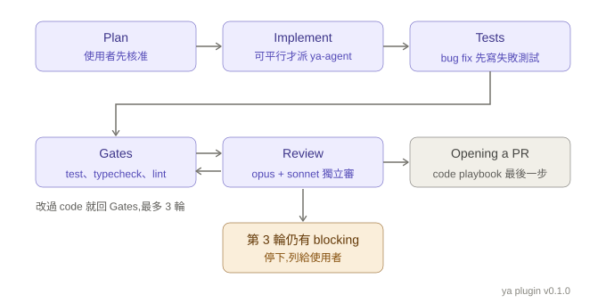
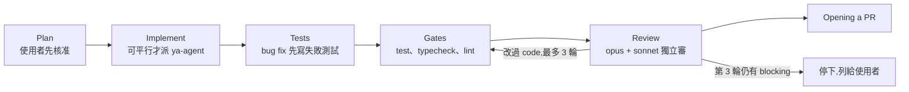

# ya-mode Code flow

Version: 0.1.0, matching the `ya` plugin version in `ya-mode/.claude-plugin/plugin.json`. Drawn from commit `d9f8424`.

Source: `ya-mode/skills/ya-mode/SKILL.md`, section "Code flow". Feature, Bug fix, Refactoring, and Perf issue run these steps.

Image files: [code-flow-v0.1.0.svg](code-flow-v0.1.0.svg), [code-flow-v0.1.0.png](code-flow-v0.1.0.png). Bump the version in the file names and here when the flow changes.

The same flow as a Mermaid diagram:

- **Plan**: read the code, post a plan, and wait for approval. A one-file change that touches no public interface needs no plan. 「全自動」 or "don't ask" skips the wait for the rest of the session.
- **Implement**: written in the main session. Spawn one `ya:ya-agent` per piece, each in its own worktree, only when the plan splits into pieces that touch disjoint files.
- **Review**: one `ya:ya-reviewer` per model on the `reviewers` line, started together with the same brief. Fix findings two or more reviewers raise. Decide solo findings with evidence. A round that changes code reruns Gates and starts fresh reviewers.
